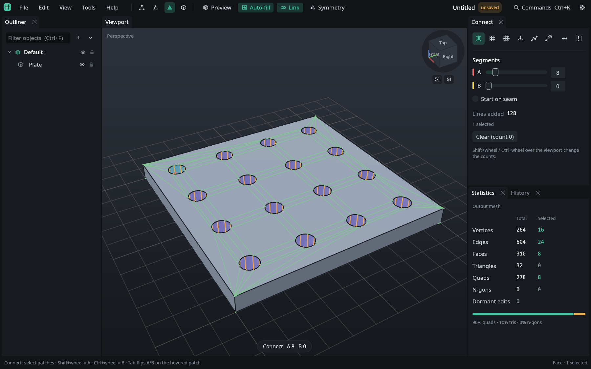

# newtopo

Turn CAD solids (STEP, IGES) into clean, game-ready polygon meshes.

newtopo loads the exact B-rep of a CAD model. Every CAD face starts as one
polygon. You add edge lines that follow the exact surfaces (Connect, Surface
Grid, Slice, Iso, Cut), auto-fill splits what's left into quads and
triangles using only existing vertices, and you export FBX, OBJ or glTF, or
send the mesh straight to Blender. Every rule stays editable: change a count
and the mesh regenerates.

**Status: early access (v0.1).** The product and engineering spec is
[`SPEC.md`](SPEC.md). What's done and what's still open is tracked in
[`docs/STATUS.md`](docs/STATUS.md).



## Install

Download the installer for your OS from
[Releases](https://github.com/SilasVogt/newtopo/releases/latest):

| OS | Package |
| --- | --- |
| Windows 10/11 x64 | `newtopo-<ver>-windows-x64-setup.exe` or portable `.zip` |
| macOS (Apple silicon) | `newtopo-<ver>-macos-arm64.dmg` |
| Linux x86-64 | `.AppImage`, `.deb` or `.tar.gz` |

Builds are not signed yet. See [`docs/INSTALL.md`](docs/INSTALL.md) for the
SmartScreen and Gatekeeper steps, and for building from source.

## Build from source

```sh
scripts/build-occt.sh "$HOME/.cache/newtopo-occt/install"   # Open CASCADE 8.0.1, once
export OCCT_DIR="$HOME/.cache/newtopo-occt/install"
cargo build --release
./target/release/newtopo
```

Windows uses `scripts\build-occt.ps1`; details in [`docs/INSTALL.md`](docs/INSTALL.md).

## Headless CLI

```sh
newtopo-cli info model.step                          # bodies, faces, surface types, layers
newtopo-cli run script.json -o out.ntopo             # apply a JSON op script
newtopo-cli validate out.ntopo                       # invariants + stats, non-zero exit on failure
newtopo-cli export out.ntopo --format fbx -o out.fbx [--triangulate] [--up y]
newtopo-cli render out.ntopo --view iso --preview -o shot.png
```

An op script:

```json
{ "version": 1, "input": "filleted_box.step",
  "ops": [ { "op": "slice", "body": 1, "count": 10 },
           { "op": "connect", "patches": { "faces": [3, 4, 5] }, "a": 8 } ] }
```

## Repository layout

| Path | What |
| --- | --- |
| `crates/occt-shim` | The only C++: a `cxx` bridge to Open CASCADE |
| `crates/kernel` | `CadKernel` trait, OCCT and analytic mock kernels, import-helper runner |
| `crates/core` | Document, rules, evaluator, auto-fill, export, bridge client (no UI, no GPU) |
| `crates/render` | wgpu renderer, in the app and headless |
| `crates/app` | The desktop app (egui) |
| `crates/cli` | `newtopo-cli` |
| `crates/import` | `newtopo-import`, the crash-isolated CAD reader process |
| `crates/testmodels` | Generates the reference STEP models |
| `addons/` | Blender (tested), Maya and 3ds Max (untested) bridge add-ons |
| `packaging/` | Installers for Windows, macOS and Linux |
| `site/` | The marketing page (GitHub Pages) |

## Licence

newtopo is MIT-licensed ([`LICENSE`](LICENSE)). It links
[Open CASCADE Technology](https://dev.opencascade.org/) dynamically, under
LGPL-2.1 with the Open CASCADE exception; the notices ship in every package.
The Blender add-on in `addons/blender` is GPL-3.0-or-later, as Blender
add-ons must be.
